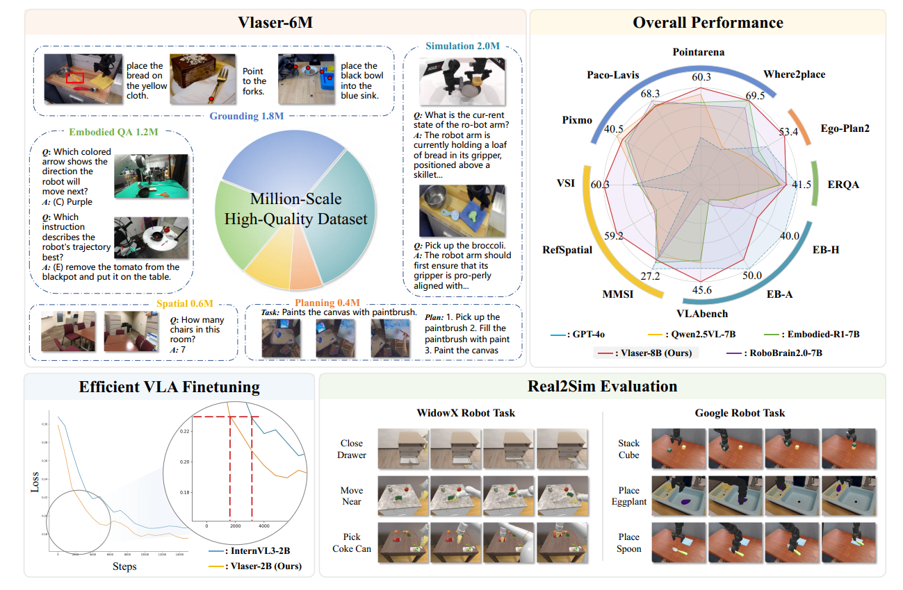

# [ICLR 2026] Vlaser: Vision-Language-Action Model with Synergistic Embodied Reasoning

 [[📜 Paper]](https://arxiv.org/pdf/2510.11027) [[⭐️Project Page]](https://internvl.github.io/blog/2025-10-11-Vlaser/) [[🤗 Model]](https://huggingface.co/collections/OpenGVLab/vlaser-68e9fd4178da453c348997f8) [[🤗 Dataset]](https://huggingface.co/datasets/ganlinyang/Vlaser) 
 <!-- [[📝 Chinese Post]](https://mp.weixin.qq.com/s/FmjG0Gp5ow7mm2Vzd9ppPg) -->


<p align="center">

<!-- <br> -->
<!-- <br> -->
<!--  -->
</p>

## ⭐️ Introduction

While significant research has focused on developing embodied reasoning capabilities using Vision-Language Models (VLMs) or integrating advanced VLMs into Vision-Language-Action (VLA) models for end-to-end robot control, few studies directly address the critical gap between upstream VLM-based reasoning and downstream VLA policy learning. In this work, we take an initial step toward bridging embodied reasoning with VLA policy learning by introducing <b>Vlaser</b> -- a <b>V</b>ision-<b>L</b>anguage-<b>A</b>ction Model with <b>s</b>ynergistic <b>e</b>mbodied <b>r</b>easoning capability, which is a foundational vision-language model designed to integrate high-level reasoning with low-level control for embodied agents. Built upon the high-quality <b>Vlaser-6M</b> dataset, Vlaser achieves state-of-the-art performance across a range of embodied reasoning benchmarks—including spatial reasoning, embodied grounding, embodied QA, and task planning.
Furthermore, we systematically examine how different VLM initializations affect supervised VLA fine-tuning, offering novel insights into mitigating the domain shift between internet-scale pre-training data and embodied-specific policy learning data. Based on these insights, our approach achieves state-of-the-art results on the WidowX benchmark and competitive performance on the Google Robot benchmark. 


## 🗞️ News
- **`2025-10-13`**: 🤖 We release Vlaser VLM model (Vlaser-2B and Vlaser-8B) as well as VLA model (Vlaser-2B-VLA) on [🤗Vlaser](https://huggingface.co/collections/OpenGVLab/vlaser-68e9fd4178da453c348997f8).
- **`2025-10-13`**: 🤖 We release the training and inference code of Vlaser VLM based on [InternVL3](https://github.com/OpenGVLab/InternVL).
- **`2025-11-7`**: 🤖 We release the training and inference code of Vlaser VLA based on [open-pi-zero](https://github.com/allenzren/open-pi-zero).
- **`2026-01-27`**: 🤖 Vlaser was accepted by ICLR 2026, congrats!
- **`2026-02-15`**: 🤖 We release the data pipeline for in-domain data based on [open-pi-zero](https://github.com/allenzren/open-pi-zero).
- **`2026-03-18`**: 🤖 We release the training dataset [🤗Vlaser-6M](https://huggingface.co/datasets/ganlinyang/Vlaser), which could help you train your own embodied brain! 🔥🔥🔥


## 📆 Todo
- [x] Release Vlaser-2B and Vlaser-8B ckpt for VLM embodied reasoning.
- [x] Release Vlaser-2B-VLA model for end-to-end robot control in SimplerEnv (WidowX and Google Robot) and RoboTwin 2.0.
- [x] Release the training and evaluation code for Vlaser VLMs.
- [x] Release the training and evaluation code for Vlaser VLAs.
- [x] Release the Dataset Generation Pipeline.
- [x] Release the Vlaser-6M Dataset.


## Vlaser VLM Quick Start
Please refer to [Vlaser_VLM](./Vlaser_VLM) for details.

## Vlaser VLA Quick Start
For SimplerEnv, Please refer to [Vlaser_VLA/Simpler](./Vlaser_VLA/Simpler) for details.
For RoboTwin 2.0, Please refer to [Vlaser_VLA/RoboTwin](./Vlaser_VLA/RoboTwin) for details.

## Data pipeline Quick Start
Please refer to [data-pipeline](./data-pipeline) for details.

## Vlaser-6M dataset Quick Start
You can download our training dataset [🤗Vlaser-6M](https://huggingface.co/datasets/ganlinyang/Vlaser), which is categorized into **Robot_QA_data** (for general Robot QA tasks), **grounding_data** (for 2D robot grounding tasks), **planning_data** (for robotic planning tasks) and **spatial_data** (for spatial intelligence tasks). Each dataset is composed of a *.jsonl file for multimodal annotation and a *.tar.gz file for images/videos.

## 🎫 License

This project is released under the [MIT License](LICENSE).

## 🖊️ Citation

If you find this work helpful in your research, please consider giving this repo a star ⭐ and citing our paper:

```bibtex
@article{yang2025vlaser,
  title={Vlaser: Vision-Language-Action Model with Synergistic Embodied Reasoning},
  author={Yang, Ganlin and Zhang, Tianyi and Hao, Haoran and Wang, Weiyun and Liu, Yibin and Wang, Dehui and Chen, Guanzhou and Cai, Zijian and Chen, Junting and Su, Weijie and others},
  journal={arXiv preprint arXiv:2510.11027},
  year={2025}
}
```

